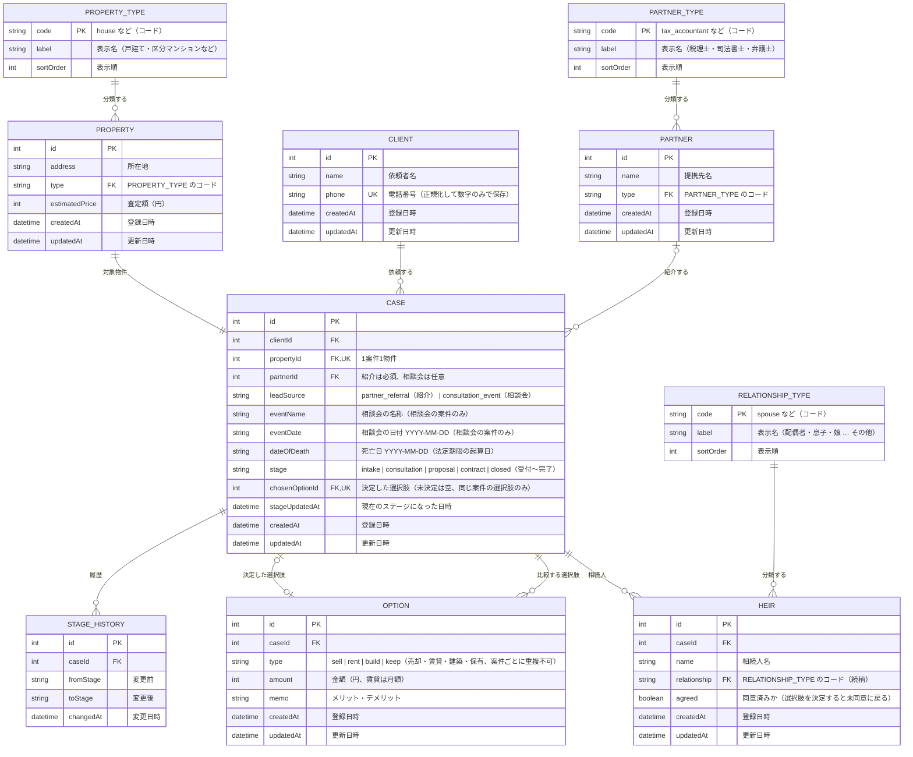
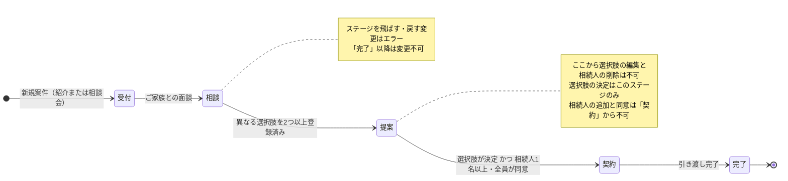
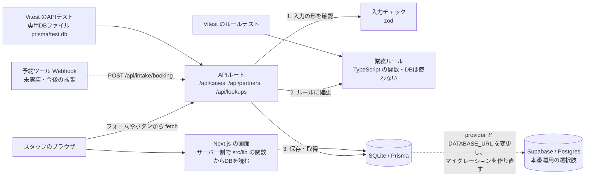
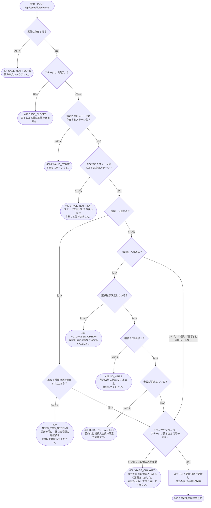

# 図

ER図・状態遷移図・システム構成図・「次のステージへ進める」処理の流れ（Mermaid。GitHub 上でそのまま表示されます）。

## 1. データモデル（ER図）

## 2. 案件の状態遷移図

## 3. システム構成図

## 4. 「次のステージへ進める」処理

URL の id の誤り（400 `INVALID_ID`）と本文の形の誤り（`toStage` がないなど、400 `INVALID_INPUT`）は、この前に拒否します。上から順に確認し、最初に当てはまった理由で拒否します。

